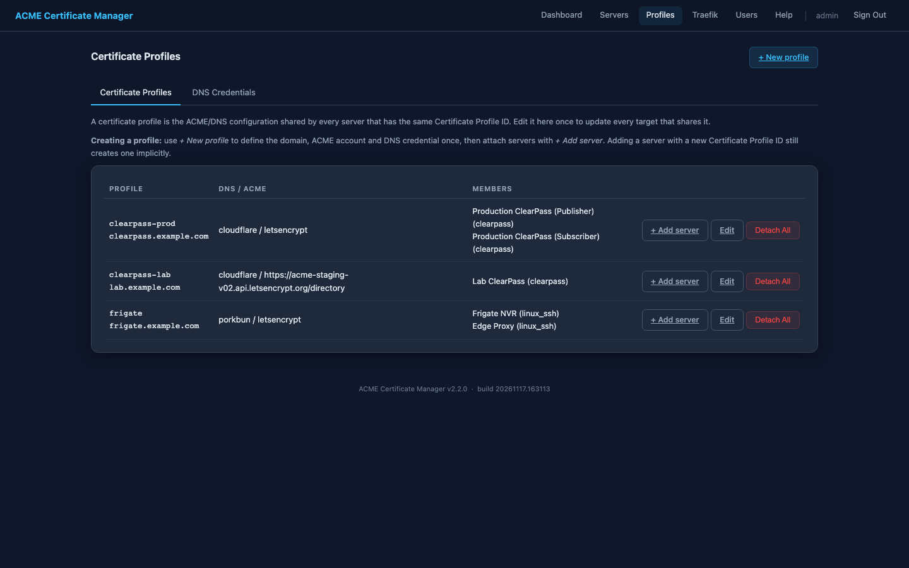
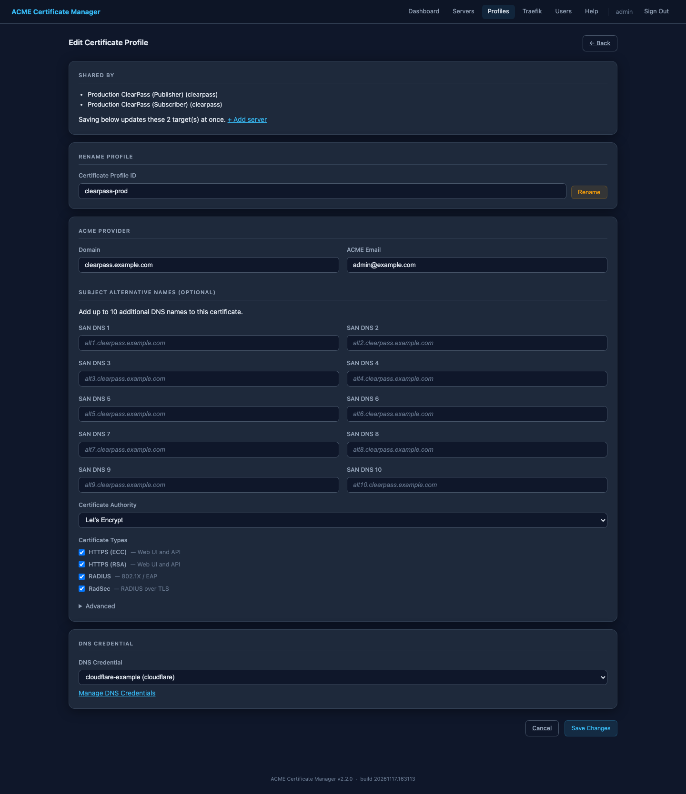
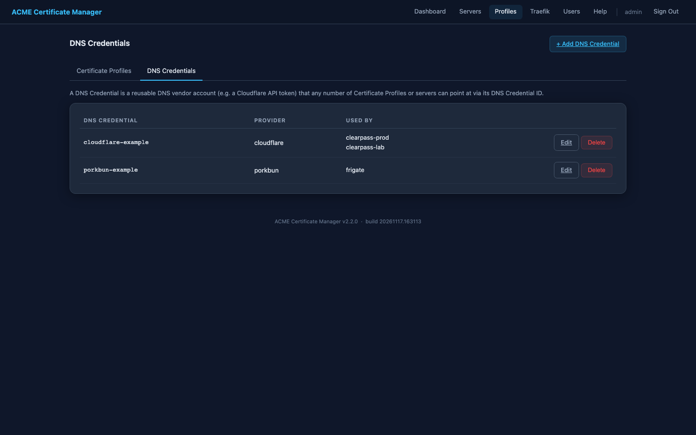

# Certificate Profiles and DNS Credentials

The **Profiles** tab in the web UI (sign-in required, route `/settings/profiles`)
manages the two things that several servers commonly share:

- **Certificate Profiles** — the ACME/DNS configuration for one certificate,
  shared by every target that uses it.
- **DNS Credentials** — a reusable DNS vendor account (for example one
  Cloudflare token) that any number of profiles can point at.

Both sub-tabs live on the same page, switched with the tab bar at the top.

## Certificate Profiles

A certificate profile is the ACME/DNS configuration shared by every server that
has the same **Certificate Profile ID**. The list shows one row per profile:

| Column | Meaning |
|---|---|
| **Profile** | The Certificate Profile ID, with the certificate's domain underneath |
| **DNS / ACME** | The DNS provider (from the linked DNS Credential) and the ACME CA |
| **Members** | Every server entry on the profile, with its target type (`clearpass` or `linux_ssh`) |

### What a profile shares

These fields are stored once per profile and applied to every member:

- Domain and extra SANs
- ACME contact email and certificate authority (including EAB credentials for ZeroSSL)
- The DNS Credential to use for the DNS-01 challenge
- Certificate types (ClearPass only; Linux SSH targets always receive the ECC certificate)
- Split-horizon DNS settings and resolvers

Everything else — host, port, API client or SSH credentials, remote directory,
reload command, service labels — stays on each server entry.

### Creating a profile

On **Certificate Profiles**, click **+ New profile**, enter a Certificate Profile
ID, the domain, ACME account and DNS credential, and save. The profile exists on
its own, with no targets yet (the list shows *No targets yet*). Then attach
servers to it:

- **+ Add server** on the profile row opens **Add Server** with the profile
  already selected and its shared ACME/DNS fields filled in.
- Or, in **Servers → + Add Server**, pick the profile from the **Certificate
  Profile** dropdown.

A profile with no targets issues nothing. **Delete** removes an empty profile
(it is refused while servers still use it; use **Detach All** first).

You can also skip this: giving a new server an ID that doesn't exist yet
creates the profile implicitly, defined by that server. It disappears again if
its last server is removed, whereas a profile made with **+ New profile**
stays until you delete it.

The stored profile is the single source of truth. Saving one server never
changes the profile other servers share; edit the profile itself to change it
for all of them. (A server that is the only member of its profile can still
edit the values from its own form.)

A profile can mix target types, so one ClearPass publisher, a subscriber and a
Linux host can all share one certificate. IDs may contain letters, numbers,
`.`, `_` and `-`.

> A profile with a single member is still a profile; it is simply not shared yet.

### How shared profiles are issued

A profile is issued **once**, and the resulting certificate is then deployed to
each member in turn. Members do not request separate certificates.

### Editing a profile

**Edit** opens the shared fields once for the whole profile. The **Shared by**
box lists every member that the save will touch.

- Saving updates all members at once.
- The save is all-or-nothing. Each member is validated with the new values
  first, and nothing is written if any one of them would be invalid.
- Changes take effect at the next renewal or manual run; saving does not
  trigger an issuance by itself.

On a server that shares its profile with others, the Add/Edit Server form shows
the shared fields **read-only**, with a notice linking to the profile editor.
This prevents one server's edit from silently changing the others.

### Renaming a profile

**Rename Profile** on the edit page changes the Certificate Profile ID on every
member. The certificate directory on disk is renamed too, so
**already-issued certificates are kept and are not reissued**. The new ID cannot
collide with another existing profile.

### Detaching

| Action | Where | Effect |
|---|---|---|
| **Detach All** | Profiles list | Clears the profile ID on every member |
| **detach this target** | Server edit form, in the shared-profile notice | Clears it on that one server |

Detaching never deletes a server. Each detached entry keeps the ACME/DNS values
it had at that moment; the difference is that later edits no longer propagate.

## DNS Credentials

A DNS Credential holds a DNS provider and its API credentials under an ID such
as `cloudflare-prod`. Profiles refer to it by ID, so the token is stored in one
place instead of being re-entered per server.

| Column | Meaning |
|---|---|
| **ID** | The DNS Credential ID |
| **Provider** | `cloudflare`, `porkbun`, `route53`, `digitalocean`, `godaddy`, and so on |
| **Used by** | The IDs of the profiles that use it, or *(unused)* |

Provider-specific credential fields and how to obtain them are in
[Initial Setup](01-initial-setup.md#dns-provider-credential-reference).

- **Add** a credential from the empty-state link or `/settings/dns-credentials/new`.
  You can also create one inline while setting up your first server.
- **Edit** changes the provider or credentials in place. The change applies to
  every profile that uses the credential at the next issuance.
- **Rename** rewrites the reference on every profile that uses it.
- **Delete** removes the credential and **detaches it from every profile that
  used it** (the profiles keep existing but have no DNS credential). Reassign a
  credential on those profiles before their next renewal, or issuance will fail
  DNS validation.

## Routes

| Page | Route |
|---|---|
| Certificate Profiles list | `/settings/profiles` |
| Edit a profile | `/settings/profiles/edit/<profile-id>` |
| DNS Credentials list | `/settings/dns-credentials` |
| New DNS Credential | `/settings/dns-credentials/new` |
| Edit a DNS Credential | `/settings/dns-credentials/edit/<credential-id>` |

All of these require sign-in. Profiles and credentials are stored with the
server configuration under `/opt/cppm-certs/` and survive container rebuilds.
